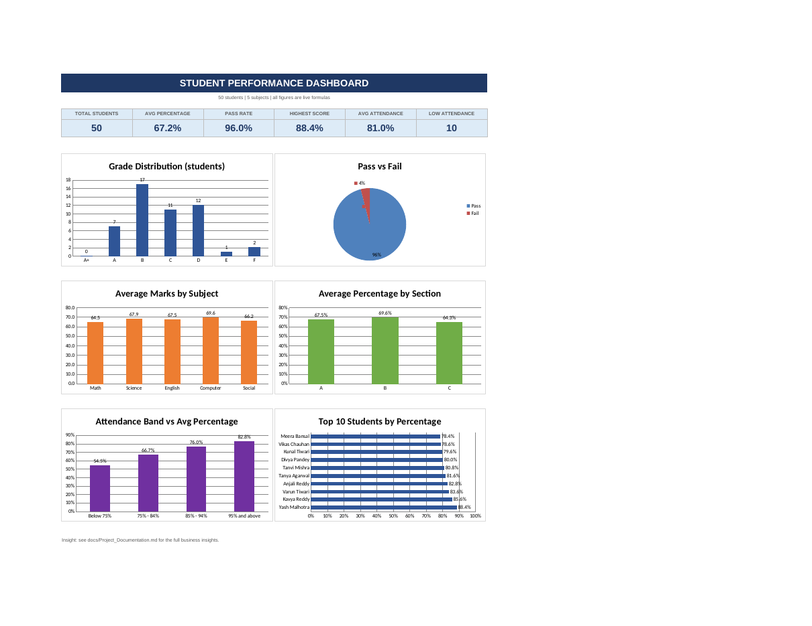

# Student Performance Analysis (Excel)

A beginner-friendly Business Analyst project that analyses the marks, attendance and results of **50 students** and presents the findings in an **Excel dashboard**.

> The dataset is **fictional** (generated for learning/portfolio use). No real student data is used.



## Business problem
A college wants to know: *Who are the top and low performers? Which subject is weakest? Does attendance affect marks? Which section needs support?*

## Tools & skills
Microsoft Excel - formulas (SUM, MIN, IF, LOOKUP, RANK, COUNTIF(S), AVERAGEIF(S), CORREL, INDEX/MATCH), Pivot-style summaries, PivotTable practice guide, charts, dashboard design, data cleaning rules, business insights.

## Project structure
```
Project1_Student_Performance_Analysis/
|-- Student_Performance_Analysis.xlsx   <- main file (open this)
|-- data/student_data_raw.csv           <- raw input data (50 rows)
|-- screenshots/dashboard.png
|-- docs/Project_Documentation.md       <- step-by-step explanation + insights
|-- docs/Interview_QA.md
|-- docs/Resume_Description.md
`-- README.md
```

## Workbook sheets
| Sheet | What it contains |
|---|---|
| Dashboard | 6 KPI cards + 6 charts |
| Student_Data | 50 students, marks, attendance + calculated columns (Total, Percentage, Result, Grade, Category, Rank) |
| Analysis | Formula-based summary tables (pass/fail, grades, subjects, section, gender, attendance bands, Top 10, Bottom 10) |
| Assumptions | Pass mark, attendance rule, grade and category tables (change them and everything recalculates) |
| Pivot_Guide | Step-by-step guide to build the same tables with real PivotTables |

## Key results
- **50 students**, average percentage **67.2%**, pass rate **96.0%** (48 passed, 2 failed)
- Top scorer: **Yash Malhotra** with **88.4%**; **7** top performers (80%+)
- Weakest subject: **Math** (average 64.5/100)
- Attendance and marks are strongly related (correlation **0.70**): students below 75% attendance average **54.5%** vs **76.0%** for 85-94% attendance

## How to use
1. Download the repository and open `Student_Performance_Analysis.xlsx` in Excel.
2. Go to the **Dashboard** sheet. Everything is formula-driven - edit marks in `Student_Data` and the dashboard updates.
3. Read `docs/Project_Documentation.md` for the full walkthrough.

## Note on PivotTables
The `Analysis` sheet contains *pivot-style summary tables built with formulas* so they always work. A `Pivot_Guide` sheet shows exactly how to create the matching real PivotTables in Excel.
